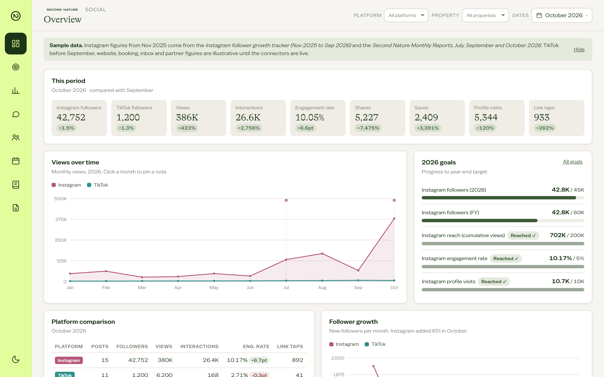
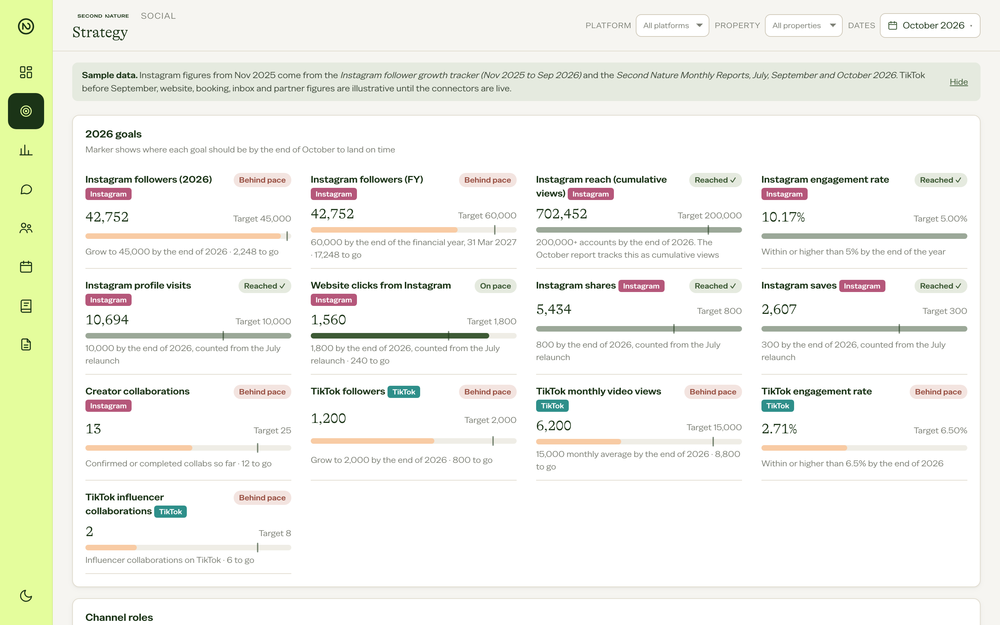
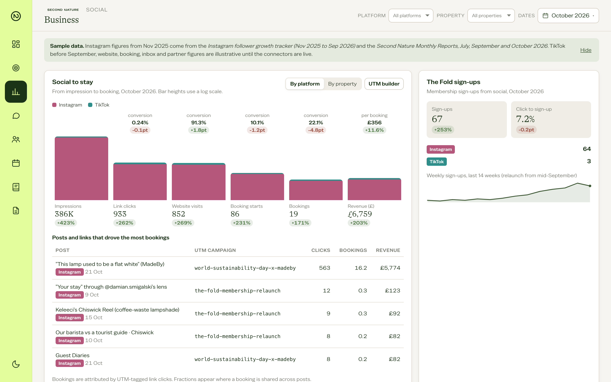
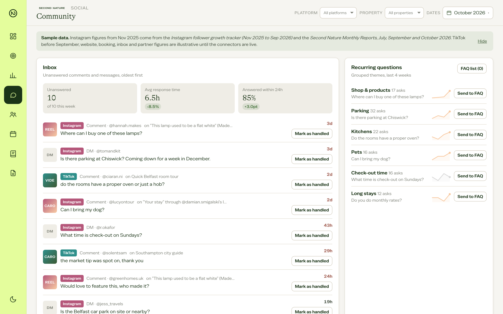
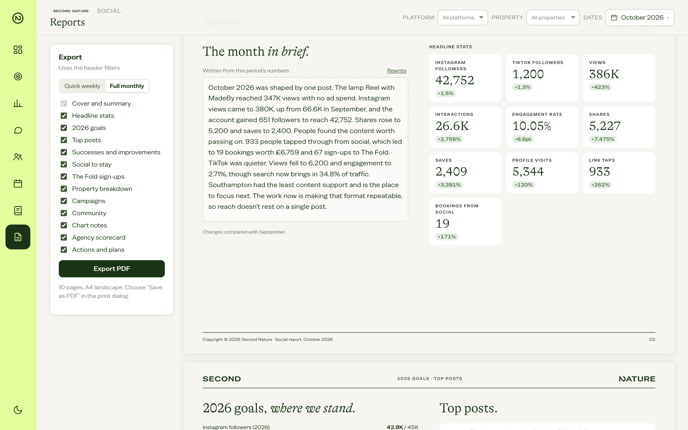
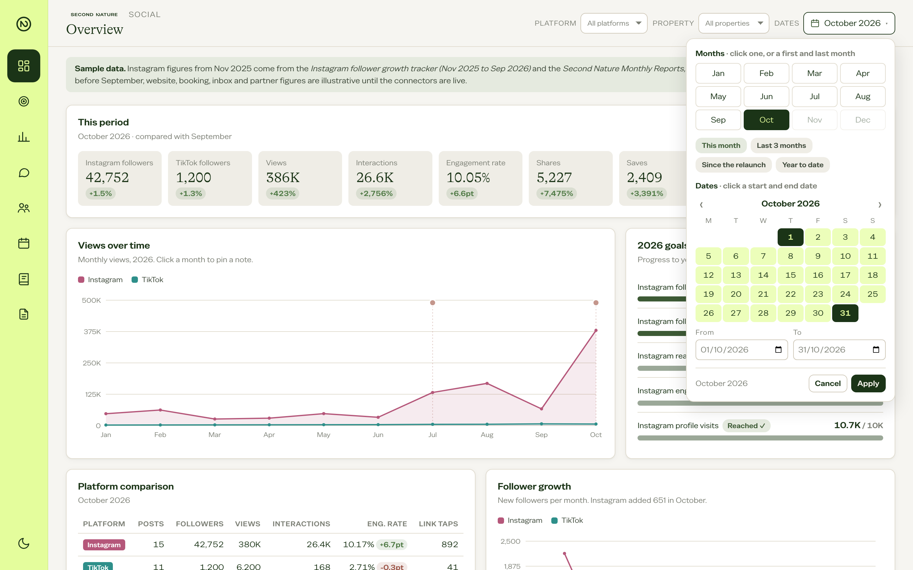
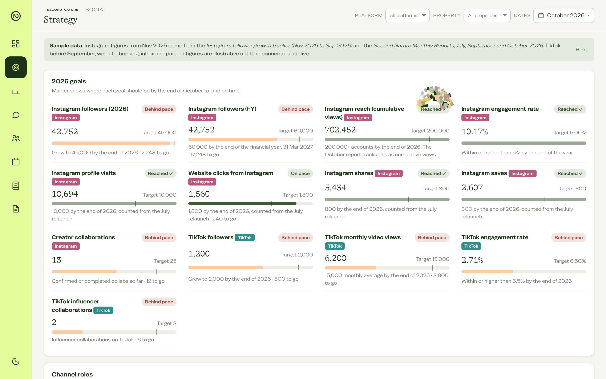

# Second Nature social dashboard

A demonstration of what a live social media dashboard could do for Second Nature, the hometel brand from Lamington Group. It shows how Instagram and TikTok performance for Chiswick, Belfast and Southampton could sit in one place. It also shows how social activity could be followed through to website visits, bookings and The Fold sign-ups, and how each month could become a report laid out like the Second Nature deck.

> **This is a demo, not a live dashboard.** Nothing here is connected to Instagram, TikTok, the website or the booking system, and the project has no API keys. It's a working prototype built from past reports and sample data, made to show what a live version could do before the connectors exist. Facebook and Facebook Ads (Meta Ads) are planned for a later stage, so that the finished dashboard covers every channel.

**Try the demo:** https://maddiefletcher96-png.github.io/second-nature-social-dashboard/



## About the project

Before this dashboard, the monthly picture lived in several places:
- a follower growth tracker spreadsheet
- a monthly report deck from the agency
- the social media strategy
- the platforms' own analytics

Each answered a different question, and none showed whether social was bringing in stays. This project shows what it would look like to set all of them against the strategy's goals and to make the monthly report from the same numbers.

Every page, filter, chart and report works, so the ideas can be tried rather than just described. The data behind it is fixed, not live:
- **From past records:** Instagram figures from November 2025 to October 2026 come from the follower growth tracker and the July, September and October 2026 monthly reports.
- **From the strategy:** the goals, pillars, personas and series come from the social media strategy.
- **Illustrative:** website, booking, inbox and partner figures, and the earlier TikTok figures, are sample data that show what the connectors would provide. The dashboard says so in a banner.
- **Written by hand:** the monthly successes and improvements were written for January to October 2026 and don't update on their own.

[docs/DATA.md](docs/DATA.md) lists where every figure comes from.

## Key features

### Overview
- **Headline stats**, each compared with the previous period. Instagram and TikTok followers are always shown separately, never added together.
- **Views over time**, with notes you can pin to any month.
- **Progress on the 2026 goals.**
- **Platform comparison, follower growth and top posts.**
- **TikTok search share and format performance.**
- **Successes and improvements for each month**, drawn from the reports and the data.

### Strategy
- **The 2026 goals from the strategy**, each with a marker showing where it should be by now.
- **A financial-year follower tracker** towards 60,000 by 31 March 2027.
- **Growth benchmarks and a month-by-month table.**
- **Content volume by format.**
- **Breakdowns by pillar, persona and signature series.**



### Business
- **Social to stay funnel:** impressions, link clicks, website visits, booking starts, bookings and revenue, by platform or by property.
- **UTM builder** for consistent tracked links.
- **The Fold sign-ups.**
- **Property breakdown and campaign tracker.**
- **Five Cares content mix.**
- **Paid vs organic,** with a switch to leave paid posts out of every other card.
- **Monthly targets.**



### Community and Partners
- **Inbox with "Mark as handled".**
- **Recurring questions** that can be sent to the FAQ list.
- **Weekly sentiment.**
- **The Stay the Night agency scorecard.**
- **Creators, PR stays and guest content,** with reshare permissions.




### Calendar
Published and planned posts, campaigns shown as bands and chart notes on their dates.


### Knowledge Hub
- **Platform updates** from the Instagram Blog, Instagram's latest updates page and the TikTok Newsroom, fetched every morning by a GitHub Action.
- **Major changes get a pop-up.** When a major functional change is announced, a pop-up appears that day, with a note on what it means for Second Nature.


### Reports
- **Two presets:** a quick weekly report and a full monthly report.
- **Page toggles** to choose which sections appear.
- **A written summary** in the Second Nature voice, generated from the period's numbers. It can be edited before export.
- **Headline stats on the same page as the summary.**
- **Export to PDF** as A4 landscape pages that follow the deck and the brand book.




### Across the dashboard
- **Filters for platform, property and dates,** which apply to every page. Pick a month, a run of months, a quick range or exact dates on a calendar. Each period is compared with the same length of time just before it.
- **Motion:**
  - numbers count up and charts build;
  - goals and targets burst into confetti in brand colours when they're reached;
  - all motion switches off when the device asks for reduced motion.
- **Dark mode.**





## Tech stack

| Part | What it uses |
| --- | --- |
| App | Plain HTML, CSS and JavaScript, with no framework and no build step |
| Charts | Hand-written SVG, with no chart library |
| Saved state | Browser localStorage, for notes, targets, handled messages and reshare statuses |
| Platform updates | Node.js and Playwright (headless Chromium), run daily by a GitHub Action |
| Fonts | Special Gothic Semi Extended (SIL Open Font License, included) and Lustria, the brand book's web stand-in for GT Alpina |
| Hosting | Any static host, such as GitHub Pages |

## Installation and setup

You need a web browser. Python 3 is only needed to serve the folder locally, and Node.js 18 or later is only needed to run the update fetcher.

1. Clone the repository:

   ```bash
   git clone https://github.com/maddiefletcher96-png/second-nature-social-dashboard.git
   ```

2. Move into the folder:

   ```bash
   cd second-nature-social-dashboard
   ```

3. Start a local server:

   ```bash
   python3 -m http.server 8765
   ```

4. Open http://localhost:8765. Double-clicking `index.html` also works, without a server.

### Running the platform update fetcher locally

1. Install the dependencies:

   ```bash
   npm install
   ```

2. Install the browser it uses:

   ```bash
   npx playwright install chromium
   ```

3. Fetch the latest updates:

   ```bash
   npm run fetch-updates
   ```

### Publishing on GitHub Pages

1. In the repository, open **Settings → Pages**.
2. Choose **Deploy from a branch**.
3. Pick `main` and `/ (root)`.

The daily update Action needs **Settings → Actions → General → Workflow permissions** set to **Read and write** so that it can commit new updates.

## Usage guide

1. **Choose what to look at.** Pick a platform, property and date range in the header. Every page follows them.
2. **Read the month.** Overview gives the headline numbers, top posts and that month's successes and improvements.
3. **Check the plan.** Strategy shows each goal against the pace it needs.
4. **Follow social through to stays.** Business shows the funnel. Build a tracked link with the UTM builder before a post goes out.
5. **Keep up with guests and partners.** Community holds the inbox and recurring questions. Partners tracks the agency, creators and guest content.
6. **Add context.** Click a point on any trend chart to pin a note, such as "giveaway went live". It appears on the chart, the calendar and the report.
7. **Stay current.** Check the Knowledge Hub for platform changes. To add a "For Second Nature" note, or to change whether an update counts as major, edit `js/update-notes.js`.
8. **Make the report.**
   - On Reports, choose weekly or monthly and turn sections on or off.
   - Edit the summary if you need to.
   - Choose **Export PDF**, and in the print dialog set the paper to A4 landscape with no margins.

## Project structure

```
index.html            app shell
css/                  tokens, layout, components, pages, motion, report, print
js/data.js            tracker, report and strategy data, plus illustrative data
js/store.js           filters, saved state and queries
js/ui.js              DOM and formatting helpers
js/charts.js          SVG charts
js/motion.js          count-up, chart build and confetti
js/summary.js         written report summary
js/insights.js        monthly successes and improvements
js/cards/             Business and Strategy cards
js/pages/             one file per page
js/app.js             navigation, header filters and routing
data/updates.js       platform updates, written by the fetcher
scripts/              platform update fetcher
assets/               logos, Five Cares icons, fonts and screenshots
.github/workflows/    daily platform update job
docs/DATA.md          where each figure comes from
```

## Design

The dashboard and reports follow the Second Nature brand book:
- **Colours:** Dark Green `#1B3417`, Light Green `#E4FD9C` and Warm Grey `#F6F5F1`, with the secondary palette for charts.
- **Type:** headlines in GT Alpina, set in Lustria on the web; body text in Special Gothic; small titles in uppercase with wide tracking.
- **Reports:** they follow the deck (Template V2), with a Dark Green cover and Warm Grey content pages framed by the split SECOND / NATURE wordmark.
- **Highlights:** tinted tiles with an icon rather than border lines.

## What it would take to go live

This project shows the idea. Making it a live dashboard would need:
- **Live data:** connections to the Instagram and TikTok APIs, website analytics and the booking system in place of the fixed and illustrative data. Each connection needs its own API key or access token. The demo has none.
- **Facebook and Facebook Ads:** a later stage adds Facebook page performance and Meta Ads spend and results, connected through Meta's APIs with an access token. They would join the existing platform filter, the paid vs organic card and the social to stay funnel, so organic and paid activity across Instagram, Facebook and TikTok can be monitored in one place.
- **Keeping keys private:** API keys can't sit in a public static site like this one. A live version would keep them on a server or in GitHub secrets, never in the page code.
- **A shared store:** a backend for team inputs (notes, targets, handled messages) so everyone sees the same ones. At the moment they're saved in each person's browser.
- **Sign-in:** to keep business figures private. As a public static site, anyone with the link can see it.
- **Automatic monthly insights:** successes and improvements written from each new month's data, either by rules in the dashboard or by an AI step run monthly. At the moment they're written by hand.

The Knowledge Hub is the one part that already updates itself. A GitHub Action fetches new platform updates every morning.
