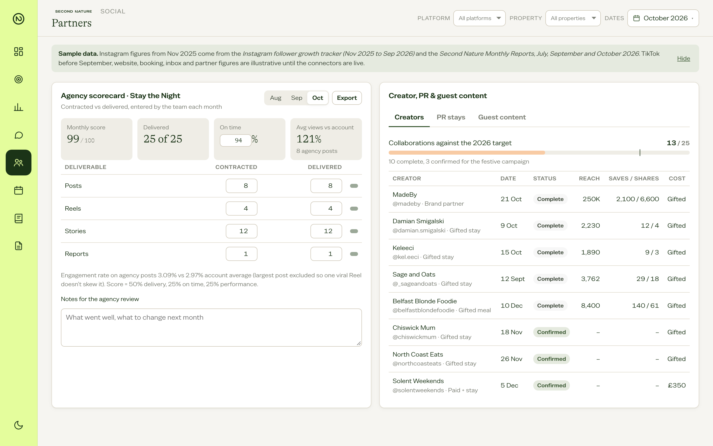
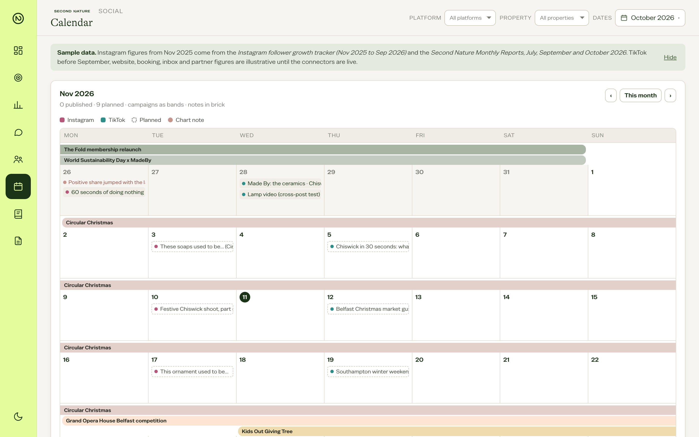
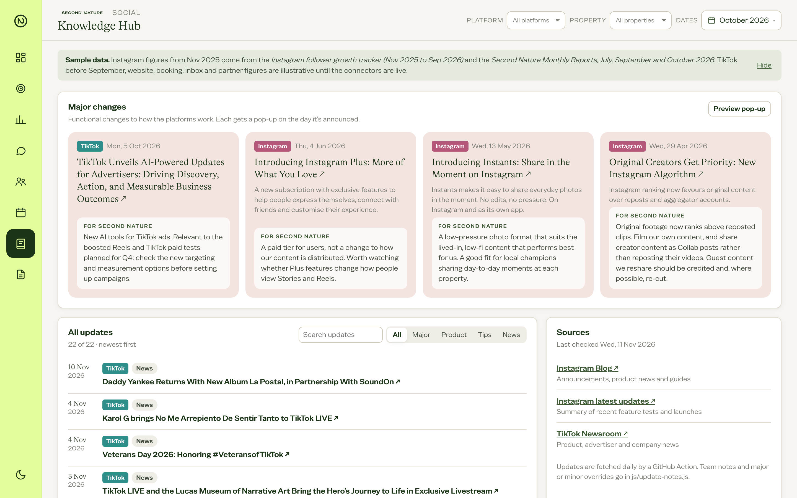
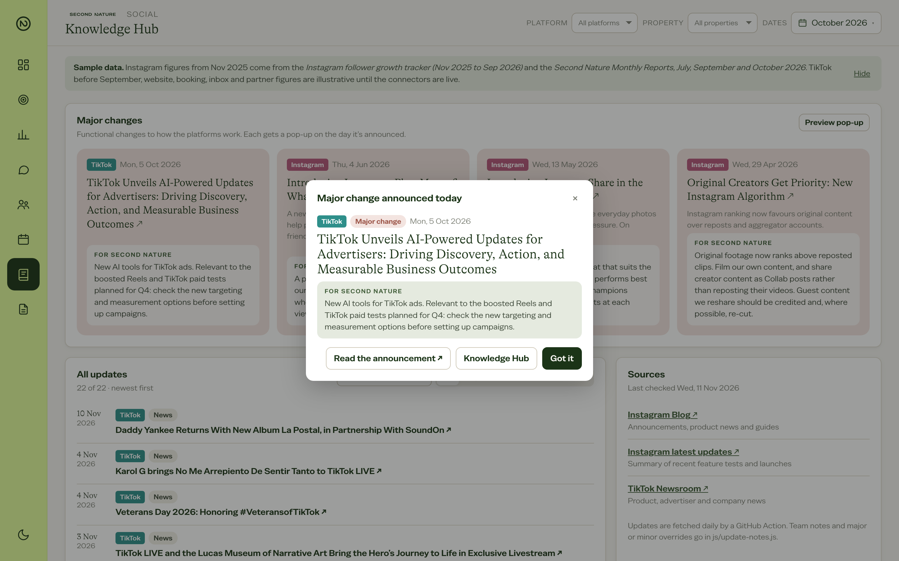
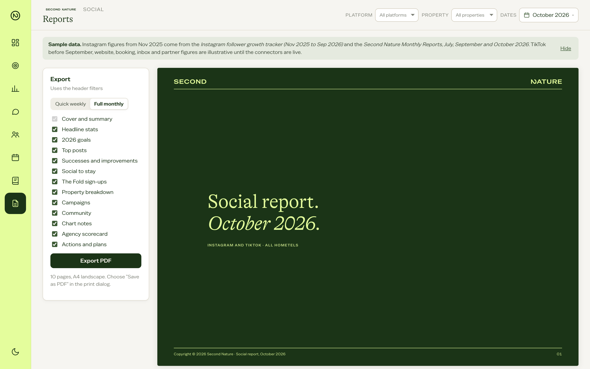

# Second Nature social dashboard

One place to see how Second Nature's social channels are performing, what they bring in and what needs doing next. It covers Instagram and TikTok across Chiswick, Belfast and Southampton, and turns the monthly numbers into reports laid out like the Second Nature deck.

The figures come from the follower growth tracker (Nov 2025 to Oct 2026), the July, September and October 2026 monthly reports and the social media strategy. Anything the platform connectors will fill in later uses illustrative data. [docs/DATA.md](docs/DATA.md) lists what is real and what is illustrative.

## Screenshots














## Key features

- **Eight pages from one icon rail.** Overview, Strategy, Business, Community, Partners, Calendar, Knowledge Hub and Reports. Hover an icon to see its label.
- **Filters that carry across every page.** Platform, property and date range. Pick one month, a run of months, a quick range or exact dates on a calendar. Each period is compared with the same length of time just before it.
- **Social to stay.** A funnel from views to bookings, a UTM link builder, The Fold sign-ups, a property breakdown, a campaign tracker, the Five Cares mix, paid vs organic and monthly targets.
- **Community.** An inbox with "Mark as handled", recurring questions you can send to the FAQ and weekly sentiment.
- **Partners.** The Stay the Night agency scorecard, creators, PR stays and guest content with reshare permissions.
- **Monthly successes and improvements.** Different for each month, drawn from the reports and the data.
- **Chart notes.** Click any point on a trend chart to pin a note. Notes show on the chart, the calendar and the report.
- **Knowledge Hub.** Updates from the Instagram Blog, Instagram's latest updates page and the TikTok Newsroom, fetched daily. Major functional changes get a pop-up on the day they're announced.
- **Reports.** An editable summary written in the Second Nature voice, headline stats on one page, toggles for a quick weekly or full monthly report and export to PDF on A4 landscape pages.
- **Motion.** Numbers count up, charts build and reached targets burst confetti in brand colours. It all switches off when the device asks for reduced motion.

## Tech stack

| Part | What it uses |
| --- | --- |
| App | Plain HTML, CSS and JavaScript. No framework, no build step |
| Charts | Hand-written SVG, no chart library |
| Saved state | Browser localStorage (notes, targets, handled messages), until a shared backend is connected |
| Platform updates | Node.js and Playwright (headless Chromium), run daily by a GitHub Action |
| Fonts | Special Gothic Semi Extended (SIL Open Font License, bundled) and Lustria from Google Fonts as the brand book's stand-in for GT Alpina |
| Hosting | Any static host, for example GitHub Pages |

## Installation and setup

You need a web browser. Python 3 is useful for serving the folder locally, and Node.js 18 or later is needed only to run the platform update fetcher.

1. Clone the repository:

   ```bash
   git clone https://github.com/<your-username>/second-nature-social-dashboard.git
   ```

2. Move into the folder:

   ```bash
   cd second-nature-social-dashboard
   ```

3. Start a local server:

   ```bash
   python3 -m http.server 8765
   ```

4. Open http://localhost:8765 in your browser. You can also double-click `index.html`, which works without a server.

To run the platform update fetcher on your own machine:

```bash
npm install
```

```bash
npx playwright install chromium
```

```bash
npm run fetch-updates
```

To publish on GitHub Pages, go to **Settings → Pages** in the repository, choose **Deploy from a branch**, then pick `main` and `/ (root)`.

## Usage guide

1. **Choose what to look at.** Use the header to pick a platform, a property and a date range. Every page follows these choices.
2. **Read the month.** Overview shows headline stats, top posts and that month's successes and improvements. Use the month chooser on the insights card to look back.
3. **Check the plan.** Strategy shows each goal against its expected pace and how the follower count tracks towards 60,000 by 31 March 2027.
4. **Follow social through to stays.** Business shows the funnel from views to bookings. Build a tracked link with the UTM builder before a post goes out.
5. **Keep up with guests.** Community holds the inbox and the questions that keep coming up.
6. **Pin context to the numbers.** Click a point on any trend chart to add a note, for example "giveaway went live" or "boosted Reel".
7. **Stay current.** The Knowledge Hub lists platform changes. To add a "For Second Nature" note or change whether an update counts as major, edit `js/update-notes.js`.
8. **Make the report.** On Reports, pick a weekly or monthly preset, turn pages on or off, edit the summary and choose **Export PDF**. In the print dialog, set the paper to A4 landscape with margins off.

Notes, targets and other team inputs are saved in your browser only, so they won't appear for colleagues until a shared backend is connected.

## Project structure

```
index.html            app shell
css/                  tokens, layout, components, pages, motion, report, print
js/data.js            data from the tracker, reports and strategy, plus illustrative data
js/store.js           filters, saved state and queries
js/ui.js              DOM and formatting helpers
js/charts.js          SVG charts
js/motion.js          count-up, chart build and confetti
js/summary.js         auto-written report summary
js/insights.js        monthly successes and improvements
js/cards/             Business and Strategy cards
js/pages/             one file per page
js/app.js             navigation, header filters and routing
data/updates.js       platform updates (written by the fetcher)
scripts/              update fetcher
assets/               logos, Five Cares icons, fonts, screenshots
.github/workflows/    daily platform update job
```

## Brand

Colours come from the Second Nature style sheet: Dark Green `#1B3417`, Light Green `#E4FD9C`, Warm Grey `#F6F5F1` and the secondary palette. Reports follow the deck (Template V2) and the brand book, with a Dark Green cover, Warm Grey content pages and the split SECOND / NATURE wordmark.
